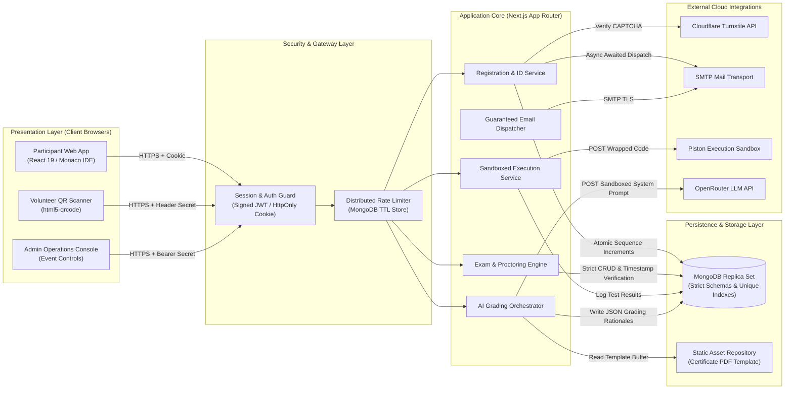

# System Architecture — Espionage Rebuild

---

## 1. Architectural Overview & Component Topology

The rebuilt architecture modernizes the single-tiered Next.js platform into an audited, secure, and distributed-ready system. It establishes strict boundary enforcement between public web interfaces, secure backend route handlers, centralized datastores, and sandboxed third-party services.

---

## 2. Component Interactions & Communication Protocols

### 2.1 Client-to-Server Protocol
- All communications run over HTTPS using JSON payloads.
- **Participant Sessions**: Identified via an `HttpOnly`, `Secure`, `SameSite=Lax` cookie containing a signed HMAC-SHA256 JWT. Bearer authentication is accepted as a fallback for headless clients.
- **Admin & Volunteer Operations**: Authenticated via dedicated request headers (`x-admin-password`, `x-attendance-secret`) verified against server environment configurations.

### 2.2 Server-to-Database Protocol
- The application connects to MongoDB using Mongoose over the native MongoDB Wire Protocol (BSON over TLS).
- Connections are pooled globally within the serverless environment to prevent connection starvation during request surges.

### 2.3 External Integrations
- **Piston Sandbox**: Dispatches user-submitted code inside language-specific wrappers over HTTPS POST to `/api/v2/execute`. Receives structured execution outputs (`stdout`, `stderr`, `exitCode`).
- **OpenRouter LLM**: Dispatches multi-turn evaluation prompts (`system` instruction + isolated `user` candidate code) over HTTPS POST to `/chat/completions`. Receives strict JSON-structured evaluation schemas.
- **Cloudflare Turnstile**: Verifies client anti-bot tokens via server-to-server POST requests to `/siteverify`.
- **Nodemailer SMTP Relay**: Delivers system notices, OTPs, QR codes, and shortlist invitations via encrypted SMTP/TLS (port 587/465).

---

## 3. External Services Inventory

| Service | Protocol / Format | Purpose | Failover / Degraded Behavior |
|---|---|---|---|
| **Cloudflare Turnstile** | HTTPS POST (URL-encoded) | Human verification on registration and OTP forms | If secret is omitted in development, bypass checks gracefully. |
| **SMTP Mail Server** | SMTP over TLS | Dispatching OTPs, attendance QR codes, and shortlist emails | Wrap dispatch in safe error boundaries so failed emails do not abort database transactions. |
| **Piston Code Runner** | HTTPS POST (JSON) | Remote code compilation and execution for C++, Python, Java | Returns structured execution errors (`COMPILE_ERROR`, `TIMEOUT`) to the candidate. |
| **OpenRouter LLM API** | HTTPS POST (JSON) | Semantic grading and partial credit evaluation | Fallback circuit-breaker awards 0 score if code failed all sample test cases or service times out. |

---

## 4. State Management Matrix

| Tier | Storage Mechanism | Data Kept | Lifecycle & Persistence |
|---|---|---|---|
| **Database** | MongoDB Collections | Participants, questions, OTPs, event configuration, proctor events | Durable, persistent across all serverless lifecycles. Indexed by unique constraints. |
| **Distributed Cache** | MongoDB TTL Collections | Rate-limit counters (`RateLimitEntry`) and active session invalidations | Ephemeral with automated TTL index expiration (5–15 minutes). |
| **Server Memory** | Global Node.js variables | Cached database connection handle (`global.mongooseCache`) | Persists across warm serverless invocations; re-instantiated on cold start. |
| **Browser Storage** | HTTP-Only Cookies | Signed participant session JWT (`esp_session`) | Cleared on explicit logout or expires after 12 hours. |
| **Browser RAM** | Client React State | Editor content, live test countdown display, UI view states | Resets on tab refresh; synced against server timestamps on reload. |
| **Disk Assets** | Static Filesystem | `public/Certificate.pdf` | Read-only static template; no dynamic writes to disk occur during runtime. |

---

## 5. Key Architectural Decisions & Rationale

### Decision 1: Signed Stateless JWTs in HttpOnly Cookies vs. In-Memory Tokens
- **Context**: The original code generated random hex tokens in `verify-otp`, returned them in JSON, and saved them to client `localStorage` while backend endpoints checked nothing.
- **Decision**: Issue a signed HMAC-SHA256 JWT inside an `HttpOnly`, `SameSite=Lax` cookie upon OTP verification. Verify the token on every protected route.
- **Rationale**: Eliminates Broken Object-Level Authorization (BOLA), prevents XSS token theft, and avoids server-side session lookup bottlenecks on serverless infrastructure.

### Decision 2: Atomic MongoDB Sequence Counter vs. Random 3-Digit IDs
- **Context**: The original used `Math.floor(100 + Math.random() * 900)` in a `while` loop, hitting an infinite loop when approaching 900 registrations.
- **Decision**: Use a dedicated `counters` collection with atomic `findOneAndUpdate({ _id: 'participantId' }, { $inc: { seq: 1 } })` to issue formatted sequential IDs (`ESP-1001`, `ESP-1002`).
- **Rationale**: Guarantees zero collisions, scales infinitely, and avoids thread contention or database deadlocks.

### Decision 3: Server-Side Start Timestamps vs. Pure Client Countdown
- **Context**: The original kept `timeLeft` in React state. Refreshing the browser reset the 45-minute or 90-minute countdown clock.
- **Decision**: Persist `round1StartedAt` and `round2StartedAt` in the database. Verify elapsed time on submission ($elapsed \le duration + grace$).
- **Rationale**: Prevents client-side timer manipulation and ensures equal testing time for all candidates regardless of browser restarts.

### Decision 4: Chunked Per-Participant AI Grading vs. Bulk Sequential Loop
- **Context**: The original evaluated 30 participants $\times$ 3 questions sequentially in one endpoint, guaranteed to trigger 504 Gateway Timeouts.
- **Decision**: Restructure the admin AI evaluation route to accept `{ participantId }`, evaluating a single participant's problems concurrently using `Promise.allSettled()`. Orchestrate the batch loop from the admin UI with a progress bar.
- **Rationale**: Keeps individual API response times under 5 seconds, easily conforming to serverless execution limits.
