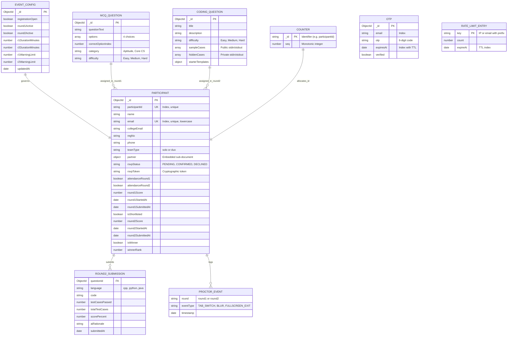

# Data Models & Schemas — Espionage Rebuild

---

## 1. Entity-Relationship Overview

The database design centers on the `Participant` entity, which encapsulates both individual participants and synchronized duo partnerships. Distinct operational entities handle event configuration, OTP life cycles, question banks, announcements, staff check-ins, rate-limiting, and sequence counters.

---

## 2. Detailed Entity Specifications

### 2.1 `Participant` Collection

Represents all registered students and their contest progression.

| Field Name | Type | Constraints / Indexes | Description |
|---|---|---|---|
| `_id` | `ObjectId` | Primary Key | Internal MongoDB document identifier |
| `participantId` | `String` | **Unique Index**, Required | Formatted ID (`ESP-1001`) generated atomically |
| `name` | `String` | Required, Trim | Full name of the primary contestant / team leader |
| `email` | `String` | **Unique Index**, Required, Lowercase | Personal email used for OTP login and communication |
| `collegeEmail` | `String` | Required, Lowercase | Verified institutional email address |
| `regNo` | `String` | Required, Trim | College registration / student ID number |
| `phone` | `String` | Required, Trim | Contact telephone number |
| `teamType` | `String` | Enum: `['solo', 'duo']`, Default: `'solo'` | Contest registration format |
| `partner` | `Subdocument` | Optional | Nested fields (`name`, `email`, `collegeEmail`, `regNo`, `phone`) for duo teams |
| `rsvpStatus` | `String` | Enum: `['PENDING', 'CONFIRMED', 'DECLINED']`, Default: `'PENDING'` | Pre-event attendance confirmation status |
| `rsvpToken` | `String` | Sparse Index | Cryptographic 32-byte hex token sent via email for RSVP confirmation |
| `attendanceRound1` | `Boolean` | Default: `false` | Desk check-in confirmation for Round 1 |
| `attendanceRound2` | `Boolean` | Default: `false` | Desk check-in confirmation for Round 2 |
| `round1QuestionIds`| `Array[ObjectId]` | Ref: `MCQQuestion` | Shuffled set of 30 questions assigned to this candidate |
| `round1Answers` | `Map[String, Number]` | Optional | Candidate's chosen options keyed by question ID |
| `round1Score` | `Number` | Default: `0`, **Compound Index** with `round1SubmittedAt` | Final calculated score for the quiz round |
| `round1StartedAt` | `Date` | Default: `null` | Server timestamp when candidate unlocked Round 1 questions |
| `round1SubmittedAt`| `Date` | Default: `null` | Server timestamp when Round 1 was finalized |
| `isShortlisted` | `Boolean` | Default: `false`, **Index** | Eligibility flag granting access to Round 2 |
| `round2QuestionIds`| `Array[ObjectId]` | Ref: `CodingQuestion` | 3 assigned problems (Easy, Medium, Hard) |
| `round2Submissions`| `Array[Subdocument]` | Optional | Array of problem submissions (code, language, test cases passed, AI score) |
| `round2Score` | `Number` | Default: `0` | Aggregated weighted score for Round 2 |
| `round2StartedAt` | `Date` | Default: `null` | Server timestamp when candidate unlocked Round 2 IDE |
| `round2SubmittedAt`| `Date` | Default: `null` | Server timestamp when Round 2 was finalized |
| `proctorEvents` | `Array[Subdocument]` | Optional | Audit trail of anti-cheat violations (`round`, `eventType`, `timestamp`) |
| `isWinner` | `Boolean` | Default: `false` | Admin flag marking event prize winners |
| `winnerRank` | `Number` | Optional | Prize ranking (1st, 2nd, 3rd place) |

---

### 2.2 `EventConfig` Collection (Singleton)

Manages global event gates and proctoring parameters.

| Field Name | Type | Constraints | Description |
|---|---|---|---|
| `_id` | `ObjectId` | Primary Key | Document identifier |
| `registrationOpen` | `Boolean` | Default: `true` | Allows or blocks public registrations |
| `round1Active` | `Boolean` | Default: `false` | Controls access to Round 1 quiz questions |
| `round2Active` | `Boolean` | Default: `false` | Controls access to Round 2 coding problems |
| `r1DurationMinutes` | `Number` | Default: `45` | Exam duration for Round 1 |
| `r2DurationMinutes` | `Number` | Default: `90` | Exam duration for Round 2 |
| `r1WarningLimit` | `Number` | Default: `5` | Anti-cheat violation ceiling before Round 1 auto-submits |
| `r2WarningLimit` | `Number` | Default: `3` | Anti-cheat violation ceiling before Round 2 locks out |
| `updatedAt` | `Date` | Auto-update | Timestamp of last administrator configuration update |

---

### 2.3 `MCQQuestion` Collection

Stores the question bank for Round 1.

| Field Name | Type | Constraints | Description |
|---|---|---|---|
| `_id` | `ObjectId` | Primary Key | Document identifier |
| `questionText` | `String` | Required | Markdown-formatted question prompt |
| `options` | `Array[String]` | Required, Length: 4 | Multiple-choice options |
| `correctOptionIndex` | `Number` | Required, Range: 0–3 | Index of correct option (kept hidden from candidate API) |
| `category` | `String` | Required | Topic tag (e.g. `DSA`, `Web`, `Cybersecurity`) |
| `difficulty` | `String` | Enum: `['easy', 'medium', 'hard']` | Question difficulty level |

---

### 2.4 `CodingQuestion` Collection

Stores programming challenges for Round 2.

| Field Name | Type | Constraints | Description |
|---|---|---|---|
| `_id` | `ObjectId` | Primary Key | Document identifier |
| `title` | `String` | Required | Problem title |
| `description` | `String` | Required | Markdown problem specification |
| `difficulty` | `String` | Enum: `['easy', 'medium', 'hard']` | Categorization for 3-tier random distribution |
| `sampleCases` | `Array[Object]` | Required | Public test cases (`input`, `expectedOutput`) returned to client |
| `hiddenCases` | `Array[Object]` | Required | Private test cases evaluated only on server submit |
| `starterTemplates` | `Map[String, String]` | Required | Default starter boilerplate for `python`, `cpp`, `java` |

---

### 2.5 `OTP` Collection

Handles short-lived authentication and email verification codes.

| Field Name | Type | Constraints / Indexes | Description |
|---|---|---|---|
| `_id` | `ObjectId` | Primary Key | Document identifier |
| `email` | `String` | Index, Lowercase | Recipient email address |
| `otp` | `String` | Required, Length: 6 | Cryptographically generated numeric code |
| `expiresAt` | `Date` | **TTL Index (`expireAfterSeconds: 0`)** | Auto-purged by MongoDB engine after 10 minutes |
| `verified` | `Boolean` | Default: `false` | Flag indicating whether code has been redeemed |

---

### 2.6 `Counter` Collection

Provides atomic sequential counters for deterministic identifier assignment.

| Field Name | Type | Constraints | Description |
|---|---|---|---|
| `_id` | `String` | Primary Key | Counter name (e.g. `'participantId'`) |
| `seq` | `Number` | Default: `1000` | Monotonically incrementing integer |

---

### 2.7 `RateLimitEntry` Collection

Provides distributed rate-limiting counters across serverless instances.

| Field Name | Type | Constraints / Indexes | Description |
|---|---|---|---|
| `key` | `String` | Primary Key, Index | Combined prefix and identifier (`otp-ip:192.168.1.1`) |
| `count` | `Number` | Default: `1` | Hit counter within the active window |
| `expireAt` | `Date` | **TTL Index (`expireAfterSeconds: 0`)** | Auto-deleted when rate-limit window closes |
