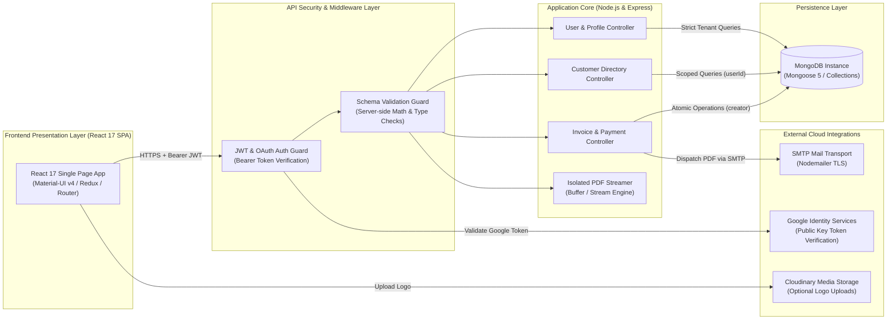

# System Architecture — Accountill Rebuild

---

## 1. Architectural Overview & Component Topology

The rebuilt architecture rectifies the unauthenticated MERN structure into an audited, secure, multi-tenant billing platform. It implements universal route-level authorization guards, concurrency-safe in-memory PDF rendering streams, and strict client data isolation.

---

## 2. Component Interactions & Communication Protocols

### 2.1 Client-to-Server Protocol
- All interactions take place over HTTPS using JSON request bodies.
- Authentication tokens are transmitted in the HTTP `Authorization: Bearer <token>` header, automatically injected via an Axios request interceptor.

### 2.2 Server Middleware & Validation
- **Authentication Middleware**: Verifies incoming custom JWT tokens against `process.env.SECRET` or verifies Google OAuth tokens against Google's public JWK certificates. Extracts the verified user ID and attaches it to `req.userId`.
- **Tenant Isolation**: Every database query on `invoices`, `clients`, or `profiles` automatically binds the filter condition to `req.userId`, preventing cross-tenant data access.

### 2.3 External Integrations
- **Google OAuth**: The server utilizes official verification routines (`google-auth-library`) to validate identity tokens emitted by `@react-oauth/google`.
- **Nodemailer SMTP Transport**: Delivers generated PDF invoices, receipts, and password reset links over secure TLS connections (port 587/465).
- **PDF Generation Engine**: Compiles HTML templates into PDF streams directly in memory or streams buffers to the client, preventing filesystem race conditions.

---

## 3. External Services Inventory

| Service | Protocol / Format | Purpose | Failover / Degraded Behavior |
|---|---|---|---|
| **SMTP Mail Server** | SMTP over TLS | Dispatching invoices, receipts, and password recovery emails | Wrapped in error handling so failed email dispatch does not corrupt saved invoice records. |
| **Google Identity Services** | HTTPS REST | Verifying Google OAuth login tokens | Users can register and sign in with native email/password credentials if Google OAuth is unreachable. |
| **Cloudinary** | HTTPS REST API | Hosting uploaded business company logos | Default fallback text banner displayed if logo image is omitted or fails to load. |

---

## 4. State Management Matrix

| Tier | Storage Mechanism | Data Kept | Lifecycle & Persistence |
|---|---|---|---|
| **Database** | MongoDB Collections | `users`, `profiles`, `clientmodels`, `invoicemodels` | Durable and persistent. Holds user accounts, branding, client directories, and invoices. |
| **Server Memory** | Express Process RAM | Active HTTP connections and dynamic PDF memory buffers | Ephemeral; destroyed immediately after streaming completes. |
| **Browser Storage** | `localStorage` | Key `'profile'`: JSON string `{ result: userObject, token }` | Persists user session across browser tabs until explicit logout. |
| **Browser RAM** | Redux Store | Invoices list, active invoice draft, client list, profile data, loading states | Hydrated on page mount via API calls; reset on browser reload. |
| **Disk Assets** | Local Filesystem | **Zero runtime disk writes** | PDF files are generated in-memory as streams/buffers, eliminating hardcoded disk writes. |

---

## 5. Key Architectural Decisions & Rationale

### Decision 1: Mandatory Authentication Middleware on All CRUD Routes
- **Context**: The original codebase left all invoice and client routes unauthenticated because `auth.js` was never mounted in router files.
- **Decision**: Mount `auth` middleware across all routes in `server/routes/invoices.js`, `server/routes/clients.js`, and `server/routes/profile.js`.
- **Rationale**: Prevents Broken Object-Level Authorization (BOLA), guarantees data privacy, and prevents unauthorized modification or deletion of financial records.

### Decision 2: In-Memory PDF Streaming vs. Hardcoded Disk File
- **Context**: The original saved every generated PDF to a single static file `server/invoice.pdf` on disk, creating race conditions where concurrent users overwrote each other's invoices.
- **Decision**: Stream PDF buffers directly to the HTTP response using `pdf.create(html).toStream((err, stream) => stream.pipe(res))` or return binary buffers.
- **Rationale**: Completely eliminates race conditions, prevents disk fill-up, and guarantees that simultaneous requests receive their own isolated documents.

### Decision 3: Cryptographic Google OAuth Token Verification
- **Context**: The original inspected token length (`token.length < 500`) and called `jwt.decode()` for Google tokens without signature checks.
- **Decision**: Validate Google ID tokens using Google's public certificate keys via `google-auth-library` (`verifyIdToken`).
- **Rationale**: Prevents trivial account impersonation through forged OAuth payloads.

### Decision 4: Server-Side Calculation Recalculation
- **Context**: The original blindly persisted client-provided `total`, `subTotal`, and `vat` numbers.
- **Decision**: Recompute subtotal, tax rates, and total amounts server-side from line item unit prices and quantities before saving to MongoDB.
- **Rationale**: Enforces financial integrity and prevents mathematical errors or client-side price tampering.
