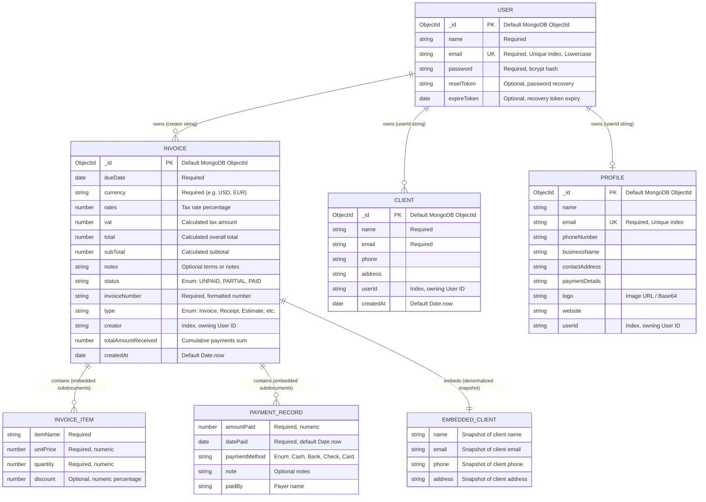

# Data Models & Schemas — Accountill Rebuild

---

## 1. Entity-Relationship Overview

The database model is composed of four primary entities: `User`, `Profile`, `Client`, and `Invoice`. The schema enforces tenant isolation by associating all business resources directly to the owning `User`.

---

## 2. High-Level Entity Summary

| Entity | Purpose | Key Fields | Indexes & Constraints | Used By (Files) |
|---|---|---|---|---|
| **User** | Authentication & business account ownership | `name`, `email`, `password`, `resetToken`, `expireToken` | `email` (Unique Index, Required) | `server/models/userModel.js`, `server/controllers/user.js`, `server/routes/userRoutes.js` |
| **Profile** | Company branding, logo, contact & bank payment instructions | `businessName`, `email`, `phoneNumber`, `contactAddress`, `paymentDetails`, `logo`, `website`, `userId` | `email` (Unique Index), `userId` (Owner Index) | `server/models/ProfileModel.js`, `server/controllers/profile.js`, `server/routes/profile.js`, `client/src/components/Settings/Settings.js` |
| **Client** | Customer contact directory for invoicing | `name`, `email`, `phone`, `address`, `userId`, `createdAt` | `userId` (Owner Index) | `server/models/ClientModel.js`, `server/controllers/clients.js`, `server/routes/clients.js`, `client/src/components/Clients/Clients.js` |
| **Invoice** | Billing documents, tax math, line items, payment installment records | `invoiceNumber`, `dueDate`, `currency`, `items`, `rates`, `vat`, `subTotal`, `total`, `status`, `creator`, `paymentRecords`, `client` | `creator` (Owner Index) | `server/models/InvoiceModel.js`, `server/controllers/invoices.js`, `server/routes/invoices.js`, `server/index.js`, `client/src/components/Invoice/Invoice.js`, `client/src/components/InvoiceDetails/InvoiceDetails.js` |

---

## 3. Detailed Entity Specifications

### 3.1 `User` Collection (Mongoose model: `User`)

Represents registered accounts on the platform.

| Field Name | Type | Constraints / Indexes | Description |
|---|---|---|---|
| `_id` | `ObjectId` | Primary Key | MongoDB internal document identifier |
| `name` | `String` | Required, Trim | User's full display name |
| `email` | `String` | **Unique Index**, Required, Lowercase | User's unique login email |
| `password` | `String` | Required | Salted bcrypt hash of user's password |
| `resetToken` | `String` | Optional, Sparse Index | Temporary hex token for password recovery |
| `expireToken`| `Date` | Optional | Timestamp when password reset token expires |

---

### 2.2 `Profile` Collection (Mongoose model: `Profile`)

Stores business company branding, contact details, and bank account instructions for invoices.

| Field Name | Type | Constraints / Indexes | Description |
|---|---|---|---|
| `_id` | `ObjectId` | Primary Key | MongoDB internal document identifier |
| `name` | `String` | Optional | Personal or representative name |
| `email` | `String` | **Unique Index**, Required | Contact business email address |
| `phoneNumber`| `String` | Optional | Business contact phone number |
| `businessName`| `String` | Optional | Official registered business or company name |
| `contactAddress`| `String`| Optional | Physical office or mailing address |
| `paymentDetails`| `String`| Optional | Bank account, wire instructions, or payment notes |
| `logo` | `String` | Optional | Cloudinary URL or image data string |
| `website` | `String` | Optional | Company homepage URL |
| `userId` | `String` | **Index**, Required | Owner User ID string |

---

### 2.3 `Client` Collection (Mongoose model: `ClientModel`)

Address book of customers and companies that can be billed.

| Field Name | Type | Constraints / Indexes | Description |
|---|---|---|---|
| `_id` | `ObjectId` | Primary Key | MongoDB internal document identifier |
| `name` | `String` | Required, Trim | Customer or company name |
| `email` | `String` | Required, Lowercase | Customer billing email |
| `phone` | `String` | Optional | Customer contact phone number |
| `address` | `String` | Optional | Customer billing address |
| `userId` | `String` | **Index**, Required | ID string of the owning User |
| `createdAt` | `Date` | Default: `Date.now` | Creation timestamp |

---

### 2.4 `Invoice` Collection (Mongoose model: `InvoiceModel`)

Primary financial document representing invoices, receipts, estimates, and payment records.

| Field Name | Type | Constraints / Indexes | Description |
|---|---|---|---|
| `_id` | `ObjectId` | Primary Key | MongoDB internal document identifier |
| `invoiceNumber` | `String` | Required | Formatted sequential serial number (e.g. `001`, `002`) |
| `type` | `String` | Enum: `['Invoice', 'Receipt', 'Estimate', 'Quotation', 'Bill']` | Document classification |
| `dueDate` | `Date` | Required | Payment due date |
| `currency` | `String` | Required, Default: `'USD'` | Currency code / symbol |
| `items` | `Array[Subdocument]` | Required | Embedded list of line items (`itemName`, `unitPrice`, `quantity`, `discount`) |
| `rates` | `Number` | Default: `0` | Tax percentage rate |
| `vat` | `Number` | Default: `0` | Computed tax / VAT amount |
| `subTotal` | `Number` | Required | Sum of line items before tax |
| `total` | `Number` | Required | Final payable total |
| `totalAmountReceived`| `Number` | Default: `0` | Cumulative sum of recorded payment installments |
| `status` | `String` | Enum: `['UNPAID', 'PARTIAL', 'PAID']`, Default: `'UNPAID'` | Current payment state |
| `client` | `Subdocument` | Required | Denormalized snapshot of client (`name`, `email`, `phone`, `address`) |
| `paymentRecords` | `Array[Subdocument]` | Default: `[]` | Embedded payment logs (`amountPaid`, `datePaid`, `paymentMethod`, `note`, `paidBy`) |
| `notes` | `String` | Optional | Additional payment terms or thank-you note |
| `creator` | `String` | **Index**, Required | Owner User ID string |
| `createdAt` | `Date` | Default: `Date.now` | Creation timestamp |

---

## 4. Storage Patterns & Schema Cleanups in Rebuild

1. **Replaced Array ID Fields with Scalar Strings**:
   In the original codebase, `userId: [String]` and `creator: [String]` were declared as arrays of strings. In this rebuild, they are normalized to scalar indexed strings (`userId: { type: String, required: true, index: true }`) to reflect strict 1-to-many ownership.
2. **Fixed Dynamic Date Initialization**:
   Replaced static `default: new Date()` with the function reference `default: Date.now` to ensure document timestamps reflect actual insertion time.
3. **Numeric Type Normalization for Line Items**:
   Replaced `unitPrice: String`, `quantity: String`, and `discount: String` with native `Number` fields to eliminate redundant string parsing and prevent mathematical corruption.
4. **Embedded Denormalized Client Snapshots**:
   Retained the embedded client document pattern in `InvoiceModel.client` to preserve immutable historical billing snapshots even if customer contact info is subsequently edited in `ClientModel`.
