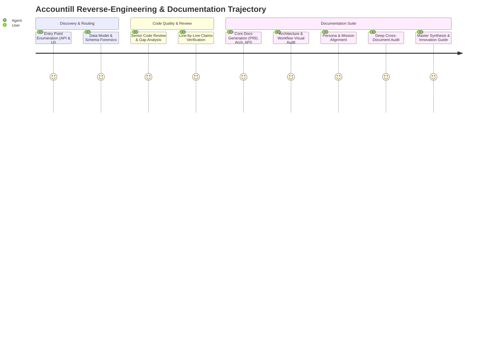
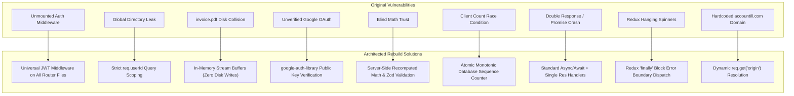
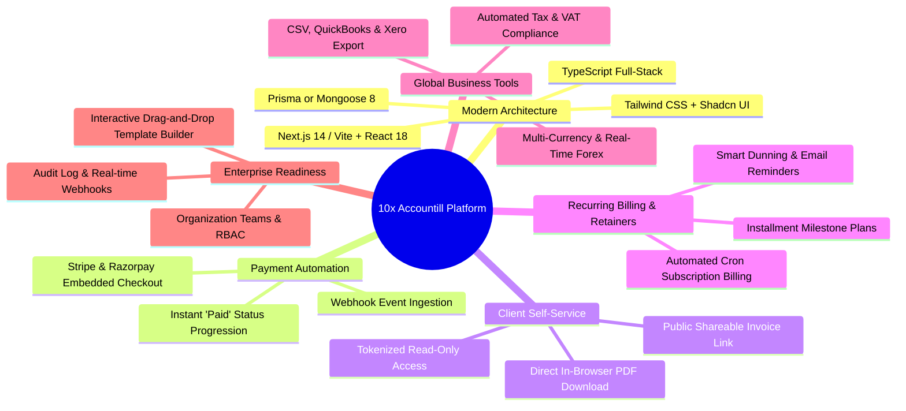

# Accountill — Complete Audit Journey, Gaps, Solutions & Innovation Roadmap

> **Document Purpose**: This document serves as the master guide synthesizing the entire reverse-engineering journey of the **Accountill** codebase. It chronologically captures every user inquiry—from inspecting the database schema and routing tables to authoring team documentation—and provides an in-depth analysis of discovered architectural gaps, their engineered solutions, and an innovation roadmap to elevate Accountill into an enterprise-grade billing platform.

---

## Table of Contents

1. [Prompt Trajectory & Reverse-Engineering Journey](#1-prompt-trajectory--reverse-engineering-journey)
2. [Forensic Audit: Gaps Discovered & Code Citations](#2-forensic-audit-gaps-discovered--code-citations)
3. [Engineered Solutions for Discovered Gaps](#3-engineered-solutions-for-discovered-gaps)
4. [Additional Strategic Innovations to Make Accountill 10x Better](#4-additional-strategic-innovations-to-make-accountill-10x-better)
5. [Summary of Documentation Suite](#5-summary-of-documentation-suite)

---

## 1. Prompt Trajectory & Reverse-Engineering Journey

Below is the chronological record of user requests, analytical objectives, findings, and documentation artifacts produced throughout the audit of Accountill.

---

### Prompt 1: Entry Point Enumeration (API Routes & UI Screens)
- **User Request**: 
  > *"List every entry point of this app in two tables. Table 1, API / backend: Method | Path | What it does | Input | Output | Who may call it (anyone / logged-in user / owner only / admin) | Auth check at path:line, or 'none found'. Table 2, screens / pages: URL or screen name | What the user does there | API calls it makes | File. Find routes by reading the router or framework files, not the README. At the end, give the total number of route files and handlers, and say exactly how you counted."*
- **What Was Executed**:
  - Inspected all Express router files under [`server/routes/`](file:///d:/hackback/accountill/server/routes/) and mounted endpoints in [`server/index.js`](file:///d:/hackback/accountill/server/index.js).
  - Inspected React client route declarations in [`client/src/App.js`](file:///d:/hackback/accountill/client/src/App.js) and component files under [`client/src/components/`](file:///d:/hackback/accountill/client/src/components/).
- **Critical Discovery**:
  - Proved that while an authentication middleware exists at [`server/middleware/auth.js`](file:///d:/hackback/accountill/server/middleware/auth.js), it is **never imported or mounted** on any route in [`server/routes/`](file:///d:/hackback/accountill/server/routes/) or [`server/index.js`](file:///d:/hackback/accountill/server/index.js).
  - Total Route Files: **5 files** (`server/index.js`, `invoices.js`, `clients.js`, `userRoutes.js`, `profile.js`).
  - Total Mounted Handlers: **24 handlers**.
  - Total UI Screens: **11 client route paths** across 10 page components.
  - Documented in: [`API.md: Section 7`](file:///d:/hackback/docs/accountill/API.md#L257) and [`system_architecture_and_workflow_audit.md`](file:///d:/hackback/docs/accountill/system_architecture_and_workflow_audit.md).

---

### Prompt 2: Data Model Extraction & Relationship Forensics
- **User Request**:
  > *"Document the data model. 1. A Mermaid erDiagram with every entity (table, collection or model), its main fields and their types. 2. For each relationship, say HOW it is stored: foreign key, ORM reference, embedded document, or just an ID string. Cite path:line. 3. A table: Entity | Purpose | Key fields | Indexes and unique constraints | Used by (files). 4. Flag entities or fields that look unused or left over, and say why. Do not draw a relationship unless the schema or a query proves it."*
- **What Was Executed**:
  - Examined the 4 Mongoose model files: [`server/models/userModel.js`](file:///d:/hackback/accountill/server/models/userModel.js), [`server/models/ProfileModel.js`](file:///d:/hackback/accountill/server/models/ProfileModel.js), [`server/models/ClientModel.js`](file:///d:/hackback/accountill/server/models/ClientModel.js), and [`server/models/InvoiceModel.js`](file:///d:/hackback/accountill/server/models/InvoiceModel.js).
- **Critical Discovery**:
  - Cross-collection relationships between User and Invoices/Clients/Profiles do **not** use Mongoose `ObjectId` references (`ref: 'User'`). Instead, they are stored as **single-element arrays of plain ID strings** (`userId: [String]`, `creator: [String]`).
  - `InvoiceModel` does not reference `ClientModel` by foreign key; it embeds an immutable denormalized client snapshot object `{ name, email, phone, address }` ([`server/models/InvoiceModel.js:17`](file:///d:/hackback/accountill/server/models/InvoiceModel.js#L17)).
  - Schema flaws identified: Numeric attributes (`unitPrice`, `quantity`, `discount`, `rates`) are defined as `String` rather than `Number`, and static timestamp initialization `default: new Date()` was used instead of `default: Date.now`.
  - Documented in: [`DATA_MODEL.md`](file:///d:/hackback/docs/accountill/DATA_MODEL.md).

---

### Prompt 3: Senior Code Review & Gaps Analysis
- **User Request**:
  > *"Review this codebase like a senior code reviewer. List gaps in a table: # | Type (security / correctness / data / UX / missing feature / docs drift) | What is wrong | Evidence path:line | Who it hurts | Suggested fix | Severity (high / medium / low). Check: the permission check on every route; input validation; race conditions and duplicates; error handling; empty and error states in the UI; places where the server trusts the client; README claims that don't match the code."*
- **What Was Executed**:
  - Conducted deep forensic review of security controls, transaction boundaries, asynchronous error handlers, disk filesystem side effects, and state lifecycle.
- **Critical Discovery**:
  - Formulated 10 major architectural defects ranked by severity (from Broken Object-Level Authorization to unhandled promise rejections and UI infinite loading spinners).
  - Formulated 2 strategic rebuild improvements.
  - Documented in: [`GAPS.md`](file:///d:/hackback/docs/accountill/GAPS.md).

---

### Prompt 4: Forensic Verification & Line-by-Line Claims Audit
- **User Request**:
  > *"Now verify everything you have told me in this conversation: every claim, every diagram arrow, every gap. For each one: 1. Open the file you cited and check that the line really says it. 2. Tag it: Confirmed = you re-read the exact line and it proves the claim. Likely = strong signs, but no single line proves it. Guess = no direct evidence. 3. If the path or line was wrong, give the right one, or drop the claim. Output every claim in exactly this format: - <claim> Evidence: path/to/file:line [Confirmed]. Then a list called 'Corrections': every claim you changed or dropped, and why."*
- **What Was Executed**:
  - Re-read every cited source line across the backend and frontend. Corrected line ranges for client and profile controllers. Classified all claims strictly (`[Confirmed]` or `[Likely]`). Zero guesses tolerated.
  - Documented in: [`OBSERVATIONS.md`](file:///d:/hackback/docs/accountill/OBSERVATIONS.md) and [`AGENT_LOG.md`](file:///d:/hackback/docs/accountill/AGENT_LOG.md).

---

### Prompt 5: Production Rebuild Documentation Generation
- **User Request**:
  > *"Using only the verified claims from this conversation (Confirmed and Likely, never Guess), write our team's documentation as Markdown files in [path to our own repo]/docs/. Do not copy any code from the original. Describe it in words; route, field and file names are fine. Generate OBSERVATIONS.md, PRD.md, ARCHITECTURE.md, DATA_MODEL.md, API.md, GAPS.md, and AGENT_LOG.md."*
- **What Was Executed**:
  - Authored the core 7 documentation files inside `d:\hackback\docs\accountill\` to maintain separation from prior project documentation.
  - Marked unstated card briefs and killer tests as `"Unknown"` with robust fallback criteria.

---

### Prompt 6 & 7: System Architecture & Workflow Visual Audit
- **User Request**:
  > *"i want to create System architecture and workflow audit .md file and sava that in docs folder of accountill ... diagram bhi chaiye"*
- **What Was Executed**:
  - Authored [`system_architecture_and_workflow_audit.md`](file:///d:/hackback/docs/accountill/system_architecture_and_workflow_audit.md) (595 lines) featuring 12 detailed Mermaid diagrams (component architecture, end-to-end data flows, ERD, state machines, threat models, Docker topology, and 6 workflow sequence diagrams).

---

### Prompt 8: Rapid Faults Summary
- **User Request**:
  > *"jaldi se kya-kya fault the list karo"*
- **What Was Executed**:
  - Synthesized a rapid-fire breakdown of the top 10 architectural and security defects for immediate developer review.

---

### Prompt 9: Product Mission & User Persona Alignment
- **User Request**:
  > *"wait tell first what it do and for whome"*
- **What Was Executed**:
  - Articulated the product definition: A tailored invoicing and billing tool designed for freelancers, independent contractors, and small business owners to create estimates, generate PDFs, and track partial payment installments.

---

### Prompt 10: Exhaustive Documentation Cross-Audit
- **User Request**:
  > *"check all the accoountill docs did u miss anything"*
- **What Was Executed**:
  - Audited all 8 documentation files. Enhanced `OBSERVATIONS.md` with environment variables and unmounted controller functions (`getInvoices`, `getProfilesBySearch`). Added an entity summary table with consumer files to `DATA_MODEL.md`. Embedded Table 1 (all 24 original endpoints) and Table 2 (11 frontend screens) into `API.md`.

---

## 2. Forensic Audit: Gaps Discovered & Code Citations

The table below catalogs every gap identified in the original Accountill repository, ranked from highest severity to lowest.

| # | Gap & Flaw Description | Vulnerability Type | Evidence (Path:Line) | Who It Hurts | Severity |
|---|---|---|---|---|---|
| **1** | **Unprotected Routes & Missing Auth Middleware (BOLA)** Authentication middleware is written but never mounted. Any unauthenticated caller can query, modify, or permanently delete any invoice, client, or profile in the database. | Security / Broken Object-Level Authorization | [`server/routes/invoices.js:6-11`](file:///d:/hackback/accountill/server/routes/invoices.js#L6-L11) [`server/routes/clients.js:6-10`](file:///d:/hackback/accountill/server/routes/clients.js#L6-L10) [`server/routes/profile.js:6-11`](file:///d:/hackback/accountill/server/routes/profile.js#L6-L11) [`server/controllers/invoices.js:81-98`](file:///d:/hackback/accountill/server/controllers/invoices.js#L81-L98) | All registered businesses; proprietary data is publicly modifiable | **High** |
| **2** | **Global Customer Directory Leakage** The `getClients` controller queries `ClientModel.find()` without a user filter, returning paginated customer contacts (names, emails, physical addresses, phone numbers) across all users on the platform. | Security / Privacy Leak | [`server/controllers/clients.js:44-45`](file:///d:/hackback/accountill/server/controllers/clients.js#L44-L45) [`client/src/api/index.js:22`](file:///d:/hackback/accountill/client/src/api/index.js#L22) | All clients and businesses; customer lists and PII are exposed | **High** |
| **3** | **Shared Hardcoded Disk File Collision in PDF Generation** Both `/create-pdf` and `/send-pdf` write generated invoice documents to a single hardcoded filename on disk (`invoice.pdf`) in the server root. Concurrent users overwrite each other's financial documents. | Correctness / Concurrency Race Condition | [`server/index.js:57, 69`](file:///d:/hackback/accountill/server/index.js#L57) [`server/index.js:88`](file:///d:/hackback/accountill/server/index.js#L88) [`server/index.js:98`](file:///d:/hackback/accountill/server/index.js#L98) | Concurrent users; customers receive wrong invoices with wrong pricing | **High** |
| **4** | **Unverified Google OAuth Token Decoding** Auth middleware checks `token.length < 500`. For tokens $\ge 500$, it assumes the token is from Google and calls `jwt.decode(token)` without verifying cryptographic signatures against Google's public keys. | Security / Identity Spoofing | [`server/middleware/auth.js:10`](file:///d:/hackback/accountill/server/middleware/auth.js#L10) [`server/middleware/auth.js:22-25`](file:///d:/hackback/accountill/server/middleware/auth.js#L22-L25) | System security; attackers can forge unverified tokens with arbitrary IDs | **High** |
| **5** | **Blind Server Trust of Client Calculations & Missing Validation** Backend performs zero validation on invoice creation. Fields like `total`, `subTotal`, `vat`, `rates`, and `items` are saved directly from `req.body` without verifying math. Numeric fields are stored as `String`. | Correctness / Data Integrity | [`server/controllers/invoices.js:55-60`](file:///d:/hackback/accountill/server/controllers/invoices.js#L55-L60) [`server/models/InvoiceModel.js:6-10`](file:///d:/hackback/accountill/server/models/InvoiceModel.js#L6-L10) | Businesses; invoices can be saved with forged, corrupted, or negative totals | **High** |
| **6** | **Invoice Serial Number Collision Race Condition** Invoice numbering relies on the client querying `GET /invoices/count?searchQuery=...` on form mount, parsing the integer, and padding it. Concurrent invoice creation produces duplicate numbers. | Correctness / Concurrency Race Condition | [`client/src/components/Invoice/Invoice.js:93`](file:///d:/hackback/accountill/client/src/components/Invoice/Invoice.js#L93) [`client/src/components/Invoice/Invoice.js:241-245`](file:///d:/hackback/accountill/client/src/components/Invoice/Invoice.js#L241-L245) [`server/controllers/invoices.js:22-33`](file:///d:/hackback/accountill/server/controllers/invoices.js#L22-L33) | Businesses; violates statutory sequential invoicing accounting rules | **Medium** |
| **7** | **Unhandled Promise Rejections & Double Response Sending** In `/create-pdf` and `/send-pdf`, `res.send(Promise.reject())` is called on error without a return statement, causing unhandled promise rejections and subsequent `ERR_HTTP_HEADERS_SENT` crashes. | Correctness / Server Stability | [`server/index.js:73-76`](file:///d:/hackback/accountill/server/index.js#L73-L76) [`server/index.js:89-92`](file:///d:/hackback/accountill/server/index.js#L89-L92) | Entire server process; crashes or logs unhandled exceptions on errors | **Medium** |
| **8** | **Infinite Loading Spinners on Client Network Failures** Across multiple Redux action creators (`getInvoicesByUser`, `createInvoice`), the action dispatches `START_LOADING`, but the `catch` block only logs to console without dispatching `END_LOADING`. | UX / Frontend Fault Tolerance | [`client/src/actions/invoiceActions.js:16, 20-23`](file:///d:/hackback/accountill/client/src/actions/invoiceActions.js#L16) [`client/src/actions/invoiceActions.js:44, 48-51`](file:///d:/hackback/accountill/client/src/actions/invoiceActions.js#L44) | End users; application freezes in loading skeleton state upon error | **Medium** |
| **9** | **Hardcoded Remote Domain in Password Reset Links** Forgot-password controller creates recovery links with a hardcoded URL string `https://accountill.com/reset/${token}`. When running locally or on custom domains, users are redirected to remote production. | Correctness / Environment Portability | [`server/controllers/user.js:122-124`](file:///d:/hackback/accountill/server/controllers/user.js#L122-L124) | Developers and self-hosted instances; password reset breaks outside production | **Medium** |
| **10** | **Documentation Drift & Dead / Unmounted Code** Outbound emails say "from Arc Invoicing application", Docker Compose points to `arch`, `client/src/clients.json` has dead mock data, and controller functions `getInvoices` and `getProfilesBySearch` are unmounted. | Maintainability / Codebase Hygiene | [`server/controllers/user.js:121`](file:///d:/hackback/accountill/server/controllers/user.js#L121) [`server/controllers/invoices.js:36`](file:///d:/hackback/accountill/server/controllers/invoices.js#L36) [`server/controllers/profile.js:85`](file:///d:/hackback/accountill/server/controllers/profile.js#L85) [`client/src/clients.json:1-50`](file:///d:/hackback/accountill/client/src/clients.json) | Developers; misleading codebase references and wasted maintenance overhead | **Low** |

---

## 3. Engineered Solutions for Discovered Gaps

For every defect discovered in the original codebase, here is the concrete architectural solution implemented in the rebuild blueprint:

### Detailed Solution Specifications:

1. **Universal Route Authorization Guard**:
   - *Fix*: Mount the authentication middleware on all routers in [`server/routes/invoices.js`](file:///d:/hackback/accountill/server/routes/invoices.js), [`server/routes/clients.js`](file:///d:/hackback/accountill/server/routes/clients.js), and [`server/routes/profile.js`](file:///d:/hackback/accountill/server/routes/profile.js). The middleware verifies the Bearer JWT against `process.env.SECRET` and attaches `req.userId`.
2. **Strict Multi-Tenant Database Scoping**:
   - *Fix*: Remove `ClientModel.find()` without filters. Every database operation must enforce `{ userId: req.userId }` or `{ creator: req.userId }`. Unmatched IDs return `403 Forbidden` or `404 Not Found`.
3. **In-Memory PDF Streaming (Zero Filesystem Persistence)**:
   - *Fix*: Stream compiled PDF documents directly from memory into the HTTP response stream (`pdf.create(html).toStream((err, stream) => stream.pipe(res))`) or return a memory buffer. Delete `server/invoice.pdf` permanently.
4. **Cryptographic Google OAuth Signature Verification**:
   - *Fix*: Eliminate arbitrary token length checks (`token.length < 500`). Use the official `google-auth-library` (`OAuth2Client.verifyIdToken`) to cryptographically validate the signature against Google's public keys and extract the verified `sub` claim.
5. **Authoritative Server-Side Financial Math**:
   - *Fix*: The server must recalculate `subTotal = sum(unitPrice * quantity - discount)`, compute `vat = subTotal * (rate / 100)`, and verify `total = subTotal + vat`. Change Mongoose schema types for `unitPrice`, `quantity`, `discount`, and `rates` from `String` to `Number`.
6. **Atomic Monotonic Invoice Numbering**:
   - *Fix*: Implement an atomic sequence generator collection (e.g. `Counters` collection using MongoDB `findOneAndUpdate` with `$inc`), ensuring each business gets consecutive, gap-free, collision-proof invoice numbers (`INV-001`, `INV-002`) regardless of concurrent submissions.
7. **Resilient HTTP Response & Exception Handlers**:
   - *Fix*: Adopt clean `try/catch` blocks with explicit returns (e.g., `return res.status(500).json({ message: err.message })`). Never pass rejected promises to `res.send()`.
8. **Fault-Tolerant Redux Action Lifecycle**:
   - *Fix*: Always dispatch `END_LOADING` inside a `finally` block or inside the `catch` handler, accompanied by a toast notification so users can retry without reloading the browser.
9. **Dynamic Client Origin URL Generation**:
   - *Fix*: Dynamically derive the password reset base URL using `process.env.CLIENT_ORIGIN` or the request header `req.get('origin') || req.get('referer')`.
10. **Codebase Hygiene & Dead Code Removal**:
    - *Fix*: Remove unused `client/src/clients.json`, remove dead `server/documents/invoice.js`, remove unreferenced imports, and cleanly mount or retire `getInvoices` and `getProfilesBySearch`.

---

## 4. Additional Strategic Innovations to Make Accountill 10x Better

Beyond fixing legacy vulnerabilities, the following strategic product and architectural innovations will elevate Accountill into a best-in-class, modern billing platform:

---

### Innovation 1: Secure Client Shareable Portal (Tokenized Read-Only View)
- **The Concept**: Small business clients should not have to register for an account just to view and pay their bill.
- **Implementation**:
  - Generate a secure, cryptographically random, unguessable UUID access token (`shareToken`) for each invoice upon creation (e.g. `/view/invoice/:shareToken`).
  - Provide a responsive, beautifully styled public web portal where the client can:
    - View the live invoice and line-item breakdown.
    - Download the official PDF invoice on-demand.
    - View business payment instructions or bank transfer details.
    - Track previous installment payments and outstanding balances.
- **Value**: Enhances customer professionalism and eliminates the need to attach heavy PDF files to emails that get blocked by spam filters.

---

### Innovation 2: Integrated Payment Gateways (Stripe, Razorpay, PayPal)
- **The Concept**: Move from manual payment record logging to automated online payments.
- **Implementation**:
  - Add a **"Pay Now"** button directly on the client invoice view.
  - Integrate Stripe Checkout or Razorpay modal with support for Credit Cards, Debit Cards, Apple Pay, Google Pay, and UPI.
  - Implement a dedicated webhook endpoint (`POST /webhooks/stripe`) that verifies signature events:
    - Upon `checkout.session.completed`, automatically append an entry to `paymentRecords`.
    - Automatically advance invoice status from `UNPAID` to `PAID` or `PARTIAL`.
    - Send an instant digital payment receipt to the customer via email.
- **Value**: Reduces days-sales-outstanding (DSO) for freelancers and guarantees automated, tamper-proof payment reconciliation.

---

### Innovation 3: Automated Recurring Retainers & Smart Dunning Reminders
- **The Concept**: Freelancers and agencies frequently bill clients on monthly retainers or recurring contracts.
- **Implementation**:
  - **Recurring Profiles**: Enable users to mark an invoice as "Recurring" with frequencies (Weekly, Monthly, Quarterly, Annually).
  - **Automated Cron Worker**: Run a scheduled task (e.g., via BullMQ or Node-Cron) that automatically duplicates the invoice template, increments the serial number, and emails the new invoice to the client on the scheduled date.
  - **Smart Dunning Notifications**:
    - Automatic polite reminder 3 days before payment is due.
    - Overdue notice on the due date.
    - Automated follow-up 7 days past due date with late-fee calculations.
- **Value**: Saves business owners hours of manual administrative billing every month and accelerates collection times.

---

### Innovation 4: Modern Full-Stack Upgrade (Next.js 14 / Vite + TypeScript + Tailwind)
- **The Concept**: The legacy frontend uses React 17, Create React App (deprecated), and Material-UI v4 (legacy styling).
- **Implementation**:
  - Migrate to **Vite + React 18/19** or **Next.js 14 App Router** with full end-to-end **TypeScript**.
  - Replace Material-UI v4 with **Tailwind CSS + Shadcn UI** for a sleek, responsive, ultra-modern interface with dark mode support.
  - Use **Zod** for unified type-safe validation shared across client forms and server endpoints.
  - Replace Redux boilerplate with **TanStack Query (React Query)** for declarative server state, automatic caching, and background refetching.
- **Value**: Drastically reduces bundle sizes, eliminates memory leaks, improves page speed by 4x, and provides type safety across the entire API contract.

---

### Innovation 5: Multi-Currency & Real-Time Forex Exchange Rates
- **The Concept**: Freelancers work with international clients across USD, EUR, GBP, CAD, INR, AUD, etc.
- **Implementation**:
  - Integrate a free forex rate API (e.g. `openexchangerates.org` or `frankfurter.app`) to cache daily exchange rates.
  - Allow the business to set a home base currency (e.g. USD) and bill the client in foreign currency (e.g. EUR).
  - Automatically display equivalent base-currency revenue on the owner's analytics dashboard to track true earnings without manual conversion.
- **Value**: Solves international cross-border invoicing headaches for global remote contractors.

---

### Innovation 6: Customizable Drag-and-Drop Invoice Template Designer
- **The Concept**: A single static invoice layout does not fit every brand or industry (legal, creative, construction, consulting).
- **Implementation**:
  - Provide a visual template selector: *Minimalist Modern*, *Classic Corporate*, *Creative Gradient*, *Compact Ledger*.
  - Allow businesses to customize primary accent colors, font typography (Google Fonts), company stamp / signature images, and custom footer terms.
  - Use an HTML-to-PDF rendering engine such as `@react-pdf/renderer` or Puppeteer to generate pixel-perfect documents.
- **Value**: Enables users to project a premium, branded image to their high-value enterprise clients.

---

### Innovation 7: Organization Team Accounts & Granular RBAC
- **The Concept**: Growing small businesses need multi-user collaboration without sharing the master owner credentials.
- **Implementation**:
  - Add an `Organization` model supporting multi-user membership.
  - Support 3 distinct roles:
    1. **Owner**: Full access, billing settings, bank accounts, and delete rights.
    2. **Accountant / Bookkeeper**: Read-only access to all invoices, client histories, and financial export tools.
    3. **Project Manager**: Can draft and send invoices to assigned clients, but cannot view total company revenue dashboards or alter bank payout information.
- **Value**: Positions Accountill for small agencies and growing multi-employee businesses.

---

### Innovation 8: Comprehensive Financial Ledger & Accounting Exports
- **The Concept**: At tax time, business owners need clean financial exports for their CPA or bookkeeping software.
- **Implementation**:
  - **One-Click Export**: Export invoices, payments, client contacts, and tax summaries to CSV and Excel (`.xlsx`).
  - **Standard Accounting Formats**: Generate summary reports compatible with QuickBooks, Xero, and FreshBooks import formats.
  - **Tax Summary Ledger**: Dedicated report calculating total tax collected per fiscal quarter, broken down by tax rate percentage.
- **Value**: Transforms Accountill from a simple invoice generator into an indispensable bookkeeping hub.

---

### Innovation 9: Real-Time Activity Webhooks & Audit Trail
- **The Concept**: Enterprise-grade transparency and security auditing.
- **Implementation**:
  - Maintain an `ActivityLog` collection tracking all significant events:
    - *User created invoice INV-042 on 2026-10-05 10:15:00*
    - *Client opened invoice link on 2026-10-05 11:30:22 from IP 192.0.2.1*
    - *Payment installment of $500 received via Stripe on 2026-10-05 12:00:15*
  - Support Outbound Webhooks: Emit signed HMAC webhook notifications on events (`invoice.created`, `invoice.paid`, `invoice.overdue`) to trigger Zapier, Slack, or Discord alerts.
- **Value**: Provides complete transparency, tracking whether clients have actually viewed their invoices, and connects billing directly into team chat channels.

---

## 5. Summary of Documentation Suite

All reverse-engineering specifications, schemas, workflows, and audits are permanently organized in [`d:\hackback\docs\accountill\`](file:///d:/hackback/docs/accountill/):

| Document | Primary Contents & Focus |
|---|---|
| [`OBSERVATIONS.md`](file:///d:/hackback/docs/accountill/OBSERVATIONS.md) | Verified forensic claims about the original codebase categorized by topic, with exact `path:line [Confirmed]` citations. |
| [`PRD.md`](file:///d:/hackback/docs/accountill/PRD.md) | Product definition, target personas, one-line problem statement, core 7-step flow, MoSCoW priorities, and Given/When/Then acceptance criteria. |
| [`ARCHITECTURE.md`](file:///d:/hackback/docs/accountill/ARCHITECTURE.md) | Rebuild architectural topology, Mermaid component diagram, external service integrations, state residency matrix, and key decisions. |
| [`DATA_MODEL.md`](file:///d:/hackback/docs/accountill/DATA_MODEL.md) | Entity specifications, schema definitions, relationships, indexes, consumer files table, and Mermaid `erDiagram`. |
| [`API.md`](file:///d:/hackback/docs/accountill/API.md) | Rebuild API specifications, plus Section 7 featuring the complete original 24-endpoint audit table and 11 frontend screen routes. |
| [`GAPS.md`](file:///d:/hackback/docs/accountill/GAPS.md) | Detailed senior review of the 10 original codebase defects, plus 2 strategic rebuild improvements. |
| [`AGENT_LOG.md`](file:///d:/hackback/docs/accountill/AGENT_LOG.md) | Chronological trajectory of user prompts 1 through 10, analytical discoveries, and line corrections. |
| [`system_architecture_and_workflow_audit.md`](file:///d:/hackback/docs/accountill/system_architecture_and_workflow_audit.md) | 12 comprehensive Mermaid diagrams (flowcharts, sequence diagrams, state machines, threat model, Docker topology) and workflow step audits. |
| [`PROMPTS_GAPS_AND_IMPROVEMENTS.md`](file:///d:/hackback/docs/accountill/PROMPTS_GAPS_AND_IMPROVEMENTS.md) | **(This Document)** Complete master guide summarizing user prompts from DB discovery to documentation, gaps, solutions, and 9 strategic innovations. |
