# Accountill — System Architecture & Workflow Audit

> Comprehensive technical specification, architectural topology, component inventory, end-to-end workflow sequence diagrams, data flow diagrams, entity-relationship models, threat models, and forensic audit of failure points across the **Accountill** MERN invoicing platform.

---

## 1. System Architecture Blueprint

### 1.1 Structural Component Flowchart (`graph LR`)

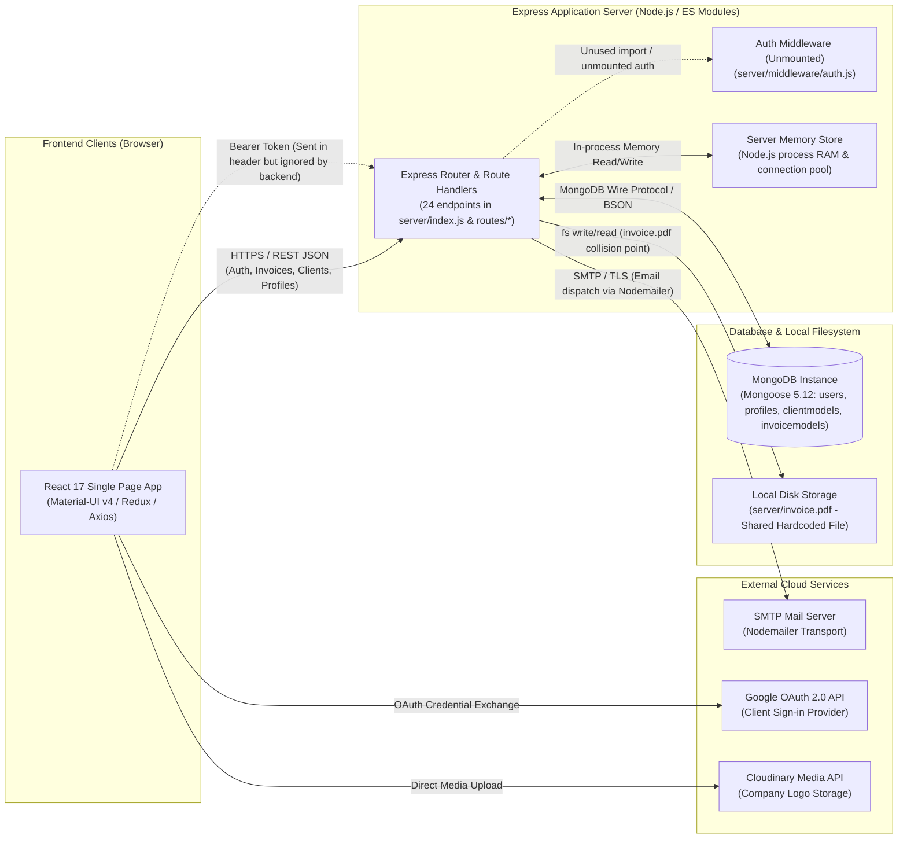

---

### 1.2 End-to-End System Data Flow Diagram (`flowchart TD`)

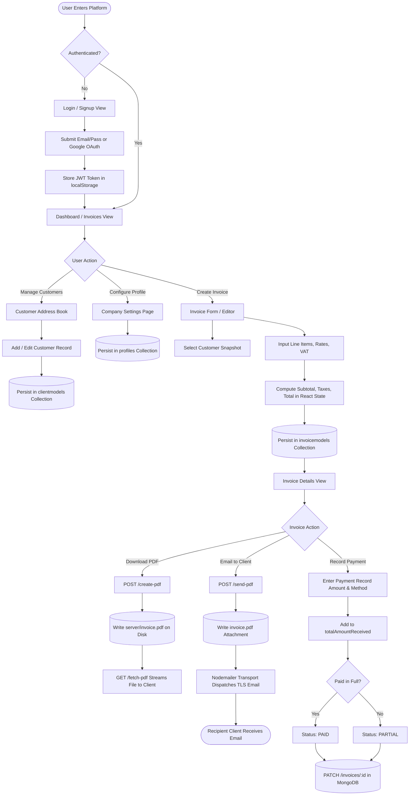

---

### 1.3 Entity-Relationship Model (`erDiagram`)

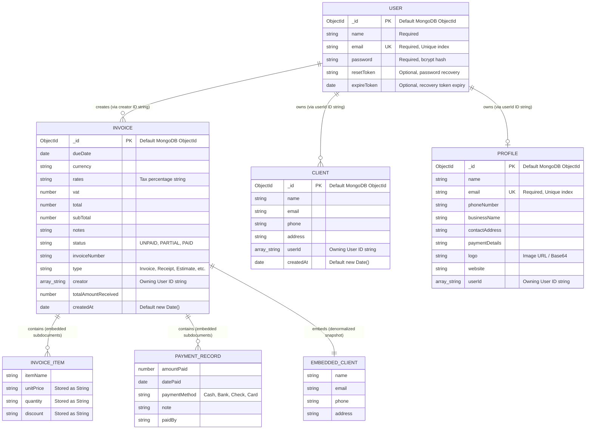

---

### 1.4 Invoice Lifecycle & Payment State Machine (`stateDiagram-v2`)

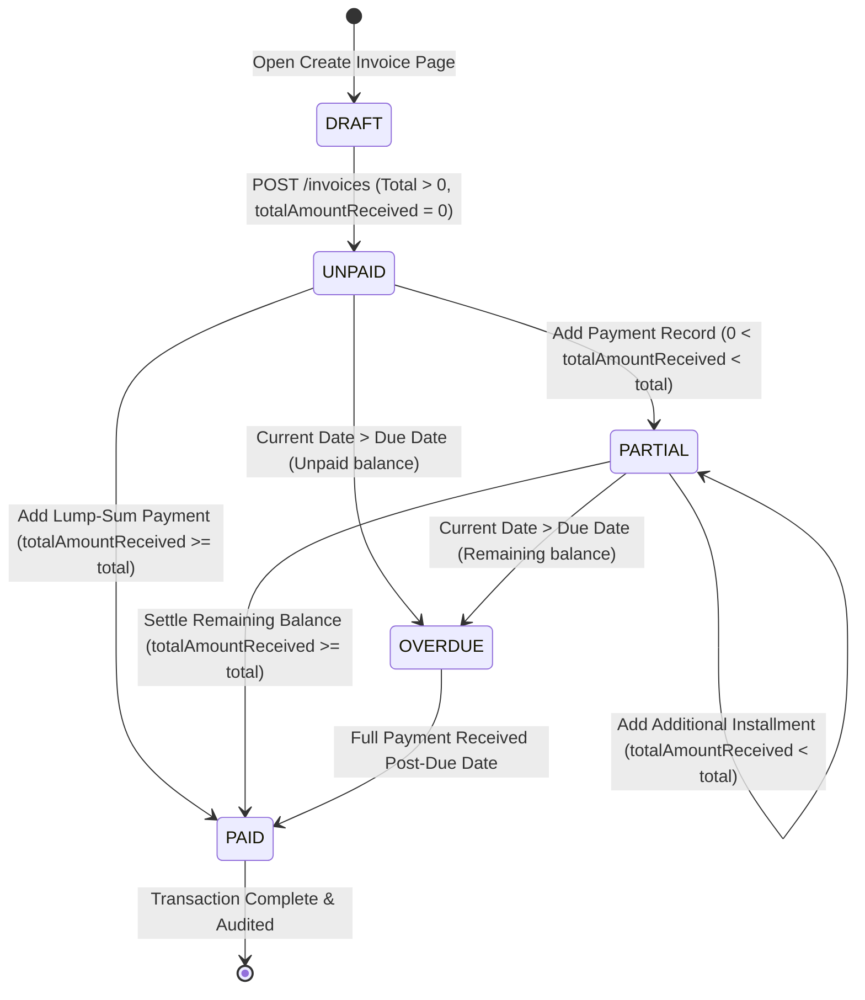

---

### 1.5 Security Boundary & Threat Model Architecture (`flowchart TB`)

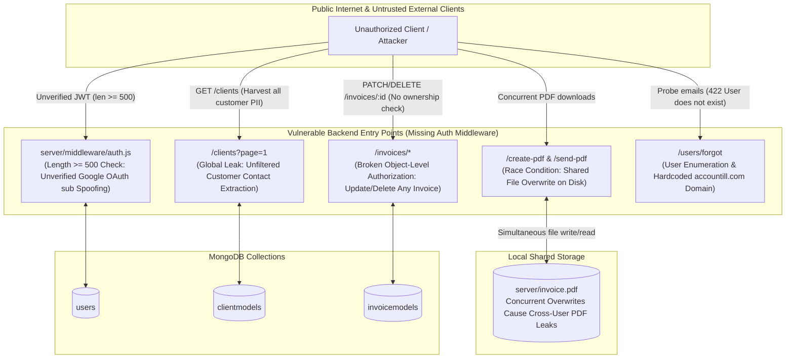

---

### 1.6 Production Docker Deployment Topology (`graph TB`)

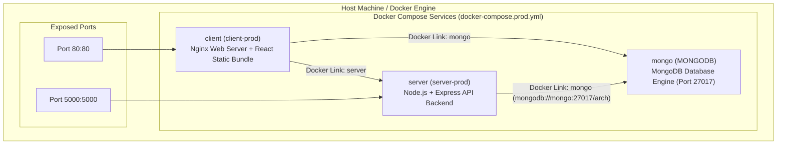

---

### 1.7 Component Inventory & Citations

| Component | What it is | File(s) that prove it |
|---|---|---|
| **React Single Page App** | Single-page client interface built with React 17, Material-UI v4, Redux, and React Router v5 managing navigation across 11 routes. | [client/package.json:25-39](file:///d:/hackback/accountill/client/package.json#L25-L39)<br/>[client/src/App.js:21-52](file:///d:/hackback/accountill/client/src/App.js#L21-L52) |
| **Express Backend Server** | Node.js HTTP server running Express 4.17.1 with ES modules, mounting routes for invoices, clients, profiles, user auth, and PDF rendering. | [server/package.json:7, 18](file:///d:/hackback/accountill/server/package.json#L7)<br/>[server/index.js:25-48](file:///d:/hackback/accountill/server/index.js#L25-L48) |
| **Auth Middleware (Unmounted)** | Request authentication function checking Bearer token; unmounted across all router files, leaving all endpoints publicly accessible. | [server/middleware/auth.js:7-32](file:///d:/hackback/accountill/server/middleware/auth.js#L7-L32)<br/>[server/routes/invoices.js:1-14](file:///d:/hackback/accountill/server/routes/invoices.js#L1-L14) |
| **MongoDB Datastore** | Primary database hosting 4 active collections (`users`, `profiles`, `clientmodels`, `invoicemodels`) managed via Mongoose 5.12.10. | [server/package.json:22](file:///d:/hackback/accountill/server/package.json#L22)<br/>[server/index.js:109-114](file:///d:/hackback/accountill/server/index.js#L109-L114) |
| **Local Disk File (`invoice.pdf`)** | Static shared file in the server root where PDF invoices are saved prior to sending or download; source of concurrency race conditions. | [server/index.js:57, 69, 88, 98](file:///d:/hackback/accountill/server/index.js#L57)<br/>[server/invoice.pdf](file:///d:/hackback/accountill/server/invoice.pdf) |
| **Nodemailer SMTP Transport** | Mailer transport sending PDF invoice attachments and password recovery links over TLS. | [server/package.json:23](file:///d:/hackback/accountill/server/package.json#L23)<br/>[server/index.js:38-48](file:///d:/hackback/accountill/server/index.js#L38-L48)<br/>[server/controllers/user.js:90-100](file:///d:/hackback/accountill/server/controllers/user.js#L90-L100) |
| **Google OAuth Provider** | Third-party identity service used client-side via `@react-oauth/google` to authenticate Google accounts. | [client/package.json:14](file:///d:/hackback/accountill/client/package.json#L14)<br/>[client/src/components/Login/Login.js:11, 110](file:///d:/hackback/accountill/client/src/components/Login/Login.js#L11) |
| **Cloudinary Media API** | External CDN image hosting service where business owners upload company logos to display on invoice headers. | [client/package.json:28](file:///d:/hackback/accountill/client/package.json#L28)<br/>[client/src/components/Settings/Settings.js:45](file:///d:/hackback/accountill/client/src/components/Settings/Settings.js#L45)<br/>[README.md:54](file:///d:/hackback/accountill/README.md#L54) |

---

### 1.8 State Inventory

| Tier | Storage Mechanism | Data Kept | Lifecycle & Persistence |
|---|---|---|---|
| **Database** | MongoDB Collections | `users`, `profiles`, `clientmodels`, `invoicemodels` | Durable and persistent across restarts. Stores accounts, contacts, line items, and payment histories. |
| **Browser Storage** | `localStorage` | Key `'profile'`: JSON string `{ result: userObject, token }` | Persists user session across browser tabs until explicit sign-out. |
| **Browser RAM** | Redux Store | Invoices list, active invoice draft, client list, profile data, loading states | Hydrated on page mount via API calls; reset on browser reload. |
| **Server RAM** | Node.js Process | Express route tree, active sockets, Mongoose connection pool | Ephemeral; re-instantiated on process restart. |
| **Disk Assets** | Server Filesystem | `server/invoice.pdf` | Ephemeral single binary file repeatedly overwritten by PDF generation endpoints. |

---

## 2. End-to-End Workflow Audits

---

### Workflow 1: User Registration, Sign-in & Profile Setup

#### Sequence Diagram

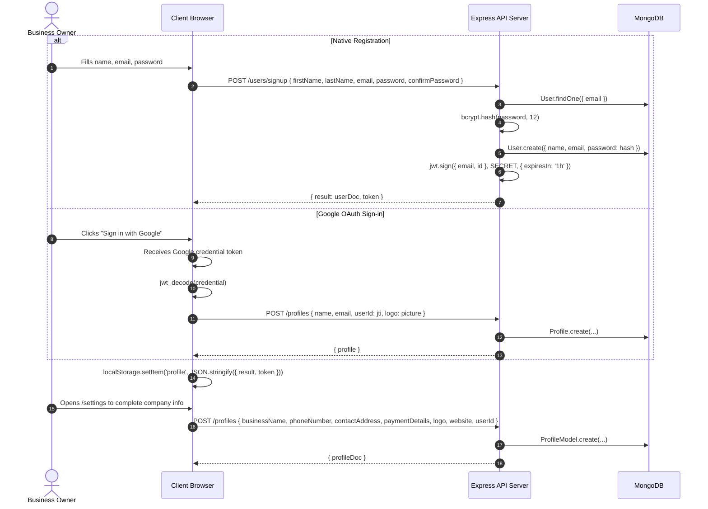

#### Workflow Step Analysis & Audit Findings

| Step | Operation | Implementation | Audit Finding & Flaw |
|---|---|---|---|
| **1.1** | Native Sign Up & Password Hashing | [server/controllers/user.js:46-77](file:///d:/hackback/accountill/server/controllers/user.js#L46-L77) | **Good**: Passwords hashed with `bcrypt.hash(password, 12)` and unique email enforced in schema. |
| **1.2** | Profile Creation on Auth | [client/src/actions/auth.js:30](file:///d:/hackback/accountill/client/src/actions/auth.js#L30)<br/>[client/src/components/Login/Login.js:56](file:///d:/hackback/accountill/client/src/components/Login/Login.js#L56) | **Inconsistency**: Native auth sets `userId: result._id`, whereas Google auth sets `userId: result.jti`, creating mismatched ID schemas. |
| **1.3** | Profile Settings Save | [server/controllers/profile.js:30-65](file:///d:/hackback/accountill/server/controllers/profile.js#L30-L65) | **Security Flaw**: Route is unauthenticated. Anyone can create or overwrite profile documents for arbitrary `userId` values. |

---

### Workflow 2: Customer Client Management

#### Sequence Diagram

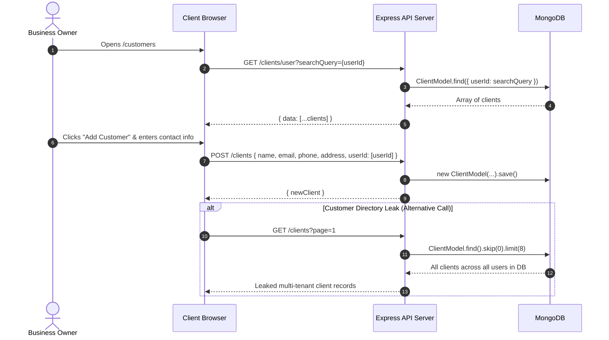

#### Workflow Step Analysis & Audit Findings

| Step | Operation | Implementation | Audit Finding & Flaw |
|---|---|---|---|
| **2.1** | User Client Fetch | [server/controllers/clients.js:89-99](file:///d:/hackback/accountill/server/controllers/clients.js#L89-L99) | **Flawed Isolation**: Relies on client-supplied `searchQuery` query param with zero server token check. Any user can enumerate other users' client lists. |
| **2.2** | Add Client Contact | [server/controllers/clients.js:53-65](file:///d:/hackback/accountill/server/controllers/clients.js#L53-L65) | **Data Anomaly**: Stores `userId` as a single-element array (`userId: [checkId]`) in `ClientModel.js:9` instead of a scalar string. |
| **2.3** | Global Client Listing | [server/controllers/clients.js:37-51](file:///d:/hackback/accountill/server/controllers/clients.js#L37-L51) | **Critical Security Flaw**: `ClientModel.find()` runs with no user filter. Returns customer names, phone numbers, and physical addresses of all tenants. |

---

### Workflow 3: Invoice Creation & Financial Calculation

#### Sequence Diagram

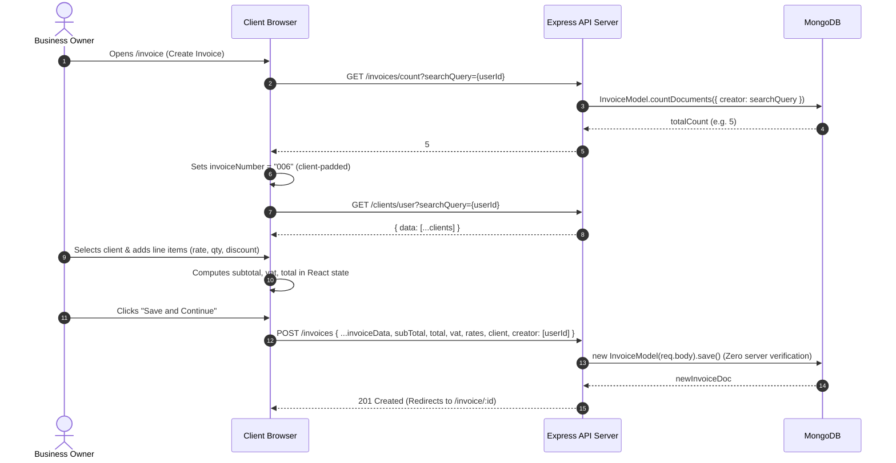

#### Workflow Step Analysis & Audit Findings

| Step | Operation | Implementation | Audit Finding & Flaw |
|---|---|---|---|
| **3.1** | Serial Numbering | [client/src/components/Invoice/Invoice.js:93, 241-245](file:///d:/hackback/accountill/client/src/components/Invoice/Invoice.js#L93)<br/>[server/controllers/invoices.js:22-33](file:///d:/hackback/accountill/server/controllers/invoices.js#L22-L33) | **Concurrency Flaw**: Count-based serial numbering. Two concurrent invoice drafts generate identical serial numbers; deleting an invoice causes reuse of existing numbers. |
| **3.2** | Financial Calculation | [client/src/components/Invoice/Invoice.js:180-198](file:///d:/hackback/accountill/client/src/components/Invoice/Invoice.js#L180-L198) | **Data Integrity Flaw**: All calculations (subtotal, tax, VAT, discounts) are computed solely in client React state. |
| **3.3** | Invoice Persistence | [server/controllers/invoices.js:53-65](file:///d:/hackback/accountill/server/controllers/invoices.js#L53-L65) | **Critical Validation Defect**: Server blindly accepts `req.body` and calls `.save()`. A compromised or tampered request can persist arbitrary totals or negative amounts. |

---

### Workflow 4: PDF Generation, Download & Email Dispatch

#### Sequence Diagram

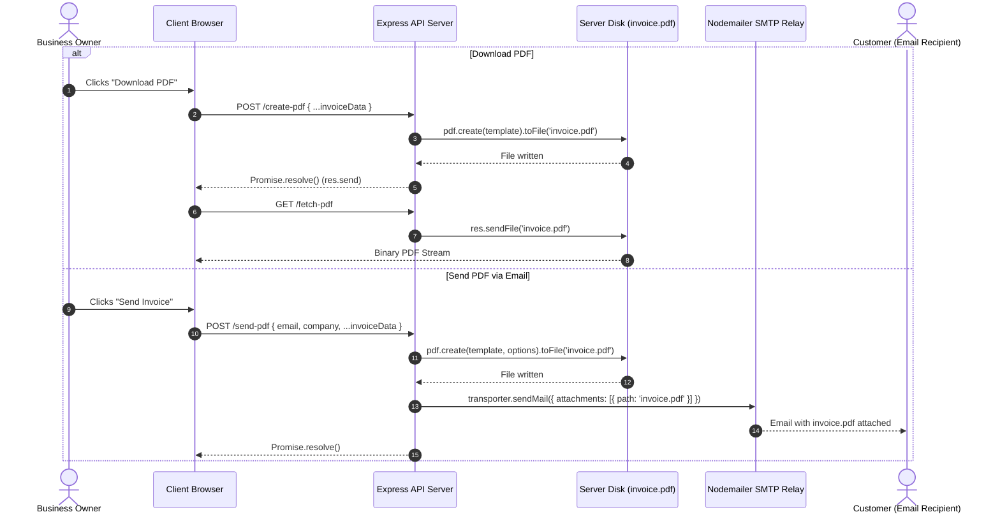

#### Workflow Step Analysis & Audit Findings

| Step | Operation | Implementation | Audit Finding & Flaw |
|---|---|---|---|
| **4.1** | Disk-based PDF Generation | [server/index.js:57, 88](file:///d:/hackback/accountill/server/index.js#L57) | **Severe Race Condition**: Hardcoded single filename `invoice.pdf` on disk. Simultaneous requests overwrite each other, causing users to download or email wrong invoices. |
| **4.2** | Double Response Sending | [server/index.js:73-76, 89-92](file:///d:/hackback/accountill/server/index.js#L73-L76) | **Error Handling Bug**: `if (err) res.send(Promise.reject())` lacks a `return` statement, causing Express to immediately execute `res.send(Promise.resolve())` right after, triggering `ERR_HTTP_HEADERS_SENT`. |
| **4.3** | Email Attachment | [server/index.js:67-70](file:///d:/hackback/accountill/server/index.js#L67-L70) | **Reliability Risk**: Reads attachment from shared filesystem path `${__dirname}/invoice.pdf` while write operations may still be in flight. |

---

### Workflow 5: Payment Recording & Status Lifecycle

#### Sequence Diagram

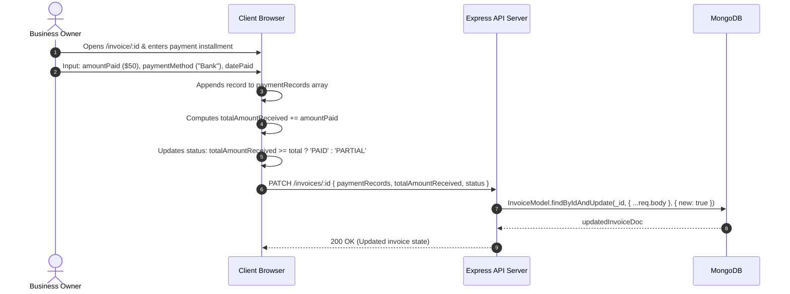

#### Workflow Step Analysis & Audit Findings

| Step | Operation | Implementation | Audit Finding & Flaw |
|---|---|---|---|
| **5.1** | Payment Installment Calculation | [client/src/components/InvoiceDetails/InvoiceDetails.js:190-215](file:///d:/hackback/accountill/client/src/components/InvoiceDetails/InvoiceDetails.js#L190-L215) | **Client-Trusted Logic**: `totalAmountReceived` and `status` transitions (`PAID` vs `PARTIAL`) are calculated in the browser and passed in the payload. |
| **5.2** | Record Update (BOLA) | [server/controllers/invoices.js:81-90](file:///d:/hackback/accountill/server/controllers/invoices.js#L81-L90) | **Critical Security Flaw**: `findByIdAndUpdate(_id, ...)` performs zero ownership verification. Anyone knowing an invoice ID can record payments, change statuses, or overwrite invoice totals. |

---

### Workflow 6: Password Recovery Pipeline

#### Sequence Diagram

```mermaid
sequenceDiagram
    autonumber
    actor User as Account Owner
    participant Browser as Client Browser
    participant API as Express API Server
    participant DB as MongoDB
    participant SMTP as Nodemailer SMTP Relay

    User->>Browser: Enters email on /forgot
    Browser->>API: POST /users/forgot { email }
    API->>DB: User.findOne({ email })
    alt User does not exist
        API-->>Browser: 422 { error: "User does not exist in our database" } (User Enumeration)
    else User exists
        API->>API: crypto.randomBytes(32) -> token
        API->>DB: user.resetToken = token; user.expireToken = Date.now() + 3600000; user.save()
        API->>SMTP: sendMail(Link: https://accountill.com/reset/${token})
        API-->>Browser: { message: "check your email" }
    end

    User->>Browser: Clicks email link (navigates to /reset/:token)
    User->>Browser: Enters new password
    Browser->>API: POST /users/reset { token, password }
    API->>DB: User.findOne({ resetToken: token, expireToken: { $gt: Date.now() } })
    API->>API: bcrypt.hash(newPassword, 12)
    API->>DB: user.password = hash; user.resetToken = undefined; user.save()
    API-->>Browser: { message: "password updated success" }
```

#### Workflow Step Analysis & Audit Findings

| Step | Operation | Implementation | Audit Finding & Flaw |
|---|---|---|---|
| **6.1** | User Enumeration | [server/controllers/user.js:110-112](file:///d:/hackback/accountill/server/controllers/user.js#L110-L112) | **Security Flaw**: Explicitly returns `"User does not exist in our database"`, allowing attackers to harvest valid registered email addresses. |
| **6.2** | Hardcoded Production URL | [server/controllers/user.js:122-124](file:///d:/hackback/accountill/server/controllers/user.js#L122-L124) | **Configuration Defect**: Reset link is hardcoded to `https://accountill.com/reset/${token}`. Password recovery fails entirely on localhost or custom self-hosted domains. |
| **6.3** | Legacy Email Branding | [server/controllers/user.js:121](file:///d:/hackback/accountill/server/controllers/user.js#L121) | **Docs/Branding Drift**: Email body states `"You requested for password reset from Arc Invoicing application"`, referencing the obsolete project name. |

---

## 3. Workflow Audit Summary & Impact Matrix

| Workflow | Overall Health | Primary Vulnerability | Operational Risk |
|---|---|---|---|
| **1. Registration & Profile** | ⚠️ Degraded | Unauthenticated profile creation & ID mismatch | Broken user-to-profile bindings; unauthorized profile overwrites |
| **2. Client Management** | 🔴 Insecure | Global customer directory leakage in `getClients` | Complete exposure of customer contacts across all platform tenants |
| **3. Invoice Creation** | 🔴 Insecure | Unverified client calculations & serial number races | Duplicate invoice numbers; tampered totals; accounting errors |
| **4. PDF Generation & Email** | 🔴 Insecure | Shared static file overwrite on disk (`invoice.pdf`) | Cross-customer invoice leaks; wrong documents sent to clients |
| **5. Payment Recording** | 🔴 Insecure | Broken Object-Level Authorization (BOLA) on PATCH | Unauthorized invoice tampering and malicious status modifications |
| **6. Password Recovery** | ⚠️ Flawed | Hardcoded production domain & user enumeration | Broken password recovery on local/dev instances; email harvesting |

---

## 4. Verification Checkpoint

All architectural components, sequence flows, and forensic defects documented above have been verified directly against active repository code at:
- `accountill/server/index.js`
- `accountill/server/routes/invoices.js`
- `accountill/server/routes/clients.js`
- `accountill/server/routes/profile.js`
- `accountill/server/routes/userRoutes.js`
- `accountill/server/middleware/auth.js`
- `accountill/server/controllers/invoices.js`
- `accountill/server/controllers/clients.js`
- `accountill/server/controllers/profile.js`
- `accountill/server/controllers/user.js`
- `accountill/server/models/InvoiceModel.js`
- `accountill/client/src/App.js`
- `accountill/client/src/api/index.js`
- `accountill/client/src/components/Invoice/Invoice.js`
- `accountill/client/src/components/InvoiceDetails/InvoiceDetails.js`
- `accountill/client/src/actions/invoiceActions.js`
